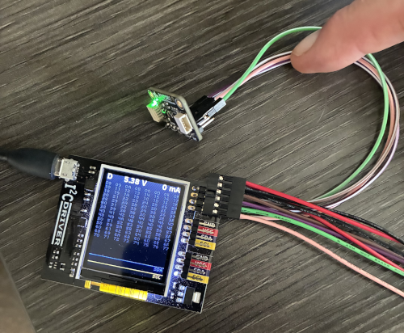

Source code this library contains example [Jupyter Notebook](https://jupyter.org/). To use it as it is you need to 
have [I2CDriver](https://i2cdriver.com/) and [BMP581](https://www.adafruit.com/product/6407) temperature and 
pressure sensor. Connect I2CDriver to your computer over USB and BMP581 to the dongle.



To try it out do following.

First make sure that you have [uv](https://docs.astral.sh/uv) command line tool installed.

On Linux or Apple computers open a terminal and run

```shell
curl -LsSf https://astral.sh/uv/install.sh | sh
```

On Windows open PowerShell window and run

```shell
powershell -ExecutionPolicy ByPass -c "irm https://astral.sh/uv/install.ps1 | iex"
```

Then in the terminal (or PowerShell) do following

```shell
git clone https://github.com/Brainless-Software/rgscore.git
cd rgscore
uv sync
uv run jupyter lab BMP581_Example.ipynb
```

Last command will start jupyter lab server and open browser with BMP581_Example.ipynb notebook opened.

You can use this notebook as example that can be adopted to your partical use case.